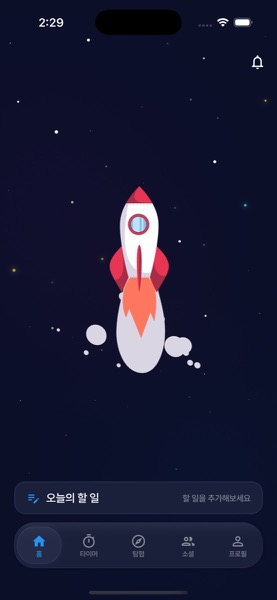
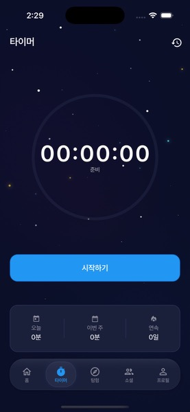
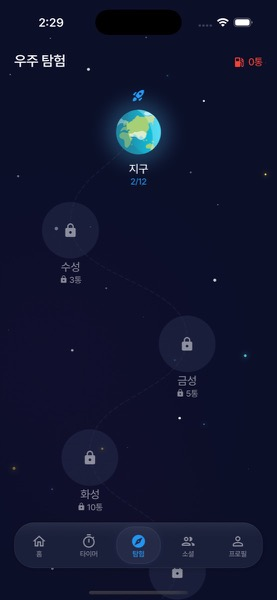
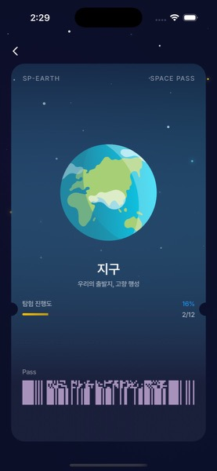
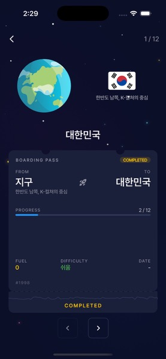
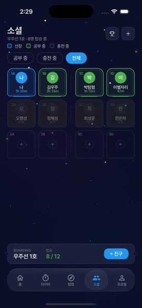

<div align="center">

# 우주공부선 (Space Study Ship)

**공부한 시간이 연료가 되어 우주를 탐험하는 게이미피케이션 Todo + Timer 앱**

[](https://flutter.dev)
[](https://dart.dev)
[](https://riverpod.dev)
[](https://firebase.google.com)
[](https://github.com/SpaceStudyShip/SpaceStudyShip-BE)

2026년 1학기 창의학기제 과제로 개발했으며, 최종 발표 당시 Google Play 비공개 테스트 버전을 게시했습니다.

</div>

<p align="center">
  
  
  
</p>
<p align="center">
  
  
  
</p>

## 왜 만들었나

할 일 목록과 타이머는 공부 계획과 시간을 기록하기엔 충분하지만, 쌓인 기록이 눈에 보이는 보상으로 이어지지는 않습니다. 기획서에서 정의한 문제도 이 두 가지였습니다.

- **동기부여 부족** — 기존 Todo/Timer 앱은 단순 기록에 그쳐 계속 쓸 동기가 약함
- **시각적 보상 부재** — 누적된 노력에 대한 눈에 보이는 성취감이 부족함

공부를 게임처럼 만들면 더 재미있게, 더 꾸준히 할 수 있겠다고 생각했습니다. 배경을 우주로 고른 것은 다음 목적지로 한 칸씩 나아가는 탐험 방식이 매일 조금씩 쌓이는 공부와 맞는다고 봤기 때문입니다.

## 주요 기능

| 기능 | 설명 |
| --- | --- |
| 할 일 · 카테고리 | 오늘의 할 일을 카테고리별로 관리하고, 타이머로 공부한 시간을 할 일에 반영 |
| 타이머 | 공부 시간을 측정하고 오늘 · 이번 주 · 연속 학습일 통계 확인 |
| 연료 | 타이머 30분마다 연료 1 적립, 30분이 안 되는 남은 분은 다음 기록으로 이월 |
| 우주 탐험 | 연료로 행성과 세부 지역을 해금 (행성 8개, 세부 지역 30개) |
| 배지 | 누적 학습 시간 · 연속 학습일 같은 목표를 채우면 획득 (6개 범주 25개, 획득 상태는 기기에 저장) |
| 게스트 모드 · 로그인 | 회원가입 없이 기기 안에서 바로 사용하거나, Google · Apple 로그인 후 서버에 저장 |

- 타이머 기록 저장 요청에는 `Idempotency-Key`를 붙여, 통신이 끊겨 같은 기록을 다시 보내도 연료가 두 번 지급되지 않습니다.
- 소셜 화면은 현재 샘플 데이터로 구성돼 있으며, 소셜과 배지의 서버 연동은 남은 과제입니다.

## 기술 스택

| 분류 | 사용 기술 |
| --- | --- |
| 프레임워크 | Flutter 3.35 (CI 기준), Dart SDK ^3.9.2 |
| 상태 관리 · 모델 | flutter_riverpod, riverpod_generator, freezed, json_serializable |
| 라우팅 | go_router |
| 네트워크 | dio, retrofit |
| 인증 · 알림 | firebase_auth, google_sign_in, sign_in_with_apple, firebase_messaging, flutter_local_notifications |
| 저장소 | shared_preferences, flutter_secure_storage |
| 모니터링 | firebase_crashlytics |
| UI | flutter_screenutil, lottie, table_calendar, showcaseview, Pretendard 폰트 |
| 테스트 | flutter_test, mocktail |
| CI/CD | GitHub Actions (main push · PR 시 `flutter analyze`, Android Play Store · iOS TestFlight 배포 워크플로우) |

## 시작하기

```bash
git clone https://github.com/SpaceStudyShip/SpaceStudyShip-FE.git
cd SpaceStudyShip-FE

# 1. 의존성 설치
flutter pub get

# 2. 루트에 .env 파일 생성 (pubspec.yaml의 assets에 포함되어 있어 파일이 있어야 빌드됩니다)
#    USE_MOCK_API=true 이면 실제 서버 대신 Mock 응답을 사용합니다
cat > .env <<'EOF'
API_BASE_URL=http://localhost:8080
USE_MOCK_API=true
EOF

# 3. 실행
flutter run
```

모델이나 Provider 코드를 수정했다면 코드 생성을 다시 실행합니다.

```bash
dart run build_runner build --delete-conflicting-outputs
flutter analyze
```

## 구조

Feature 단위로 나눈 Clean Architecture 구조이며, 의존성 방향은 `Presentation → Domain ← Data`입니다.

```
lib/
├── core/        # 공통 설정, 네트워크, 저장소, 테마, 공용 위젯
├── features/    # 기능별 모듈 (data / domain / presentation)
│   ├── auth         # 로그인 · 게스트 모드
│   ├── todo         # 할 일 · 카테고리
│   ├── timer        # 타이머 · 학습 기록
│   ├── fuel         # 연료 적립 · 이월
│   ├── exploration  # 행성 · 지역 해금
│   ├── badge        # 배지
│   ├── social       # 소셜 (샘플 데이터)
│   └── home, explore, profile, ranking, settings
└── routes/      # go_router 라우팅
```

관련 문서

- [기획서 (PRD)](docs/우주공부선PRD.md)
- [API 명세서](docs/API_명세서.md) · [DB 스키마](docs/DB_schema.md)
- [디자인 가이드](DESIGN.md)
- [백엔드 저장소](https://github.com/SpaceStudyShip/SpaceStudyShip-BE)

## 팀 · 기여자

| 이름 | 역할 |
| --- | --- |
| [홍의민 (EM-H20)](https://github.com/EM-H20) | 기획, Flutter 앱 전체 개발 (할 일 · 타이머 · 연료 · 탐험 · 배지 · 게스트 모드 · 로그인), 백엔드 도메인 · 인증 기능 개발 |
| [SUH SAECHAN (Cassiiopeia)](https://github.com/Cassiiopeia) | PR 댓글 빌드 트리거 워크플로우 수정, 백엔드 초기 멀티모듈 구조 · Security · Swagger · CI/CD · API 스펙 문서 |

## 라이선스

[SpaceStudyShip Source Available License](LICENSE) (Elastic License 2.0 기반). 앱에 사용한 행성 일러스트 등 외부 에셋의 출처는 [ASSETS_LICENSE.md](ASSETS_LICENSE.md)에 있습니다.

---

<!-- AUTO-VERSION-SECTION: DO NOT EDIT MANUALLY -->
<!-- 이 섹션은 .github/workflows/PROJECT-README-VERSION-UPDATE.yaml에 의해 자동으로 업데이트됩니다 -->
<!-- 수정하지마세요 자동으로 동기화 됩니다 -->
<!-- AUTO-VERSION-SECTION: DO NOT EDIT MANUALLY -->
## 최신 버전 : v1.1.43 (2026-03-16)

[전체 버전 기록 보기](CHANGELOG.md)
<!-- END-AUTO-VERSION-SECTION -->
